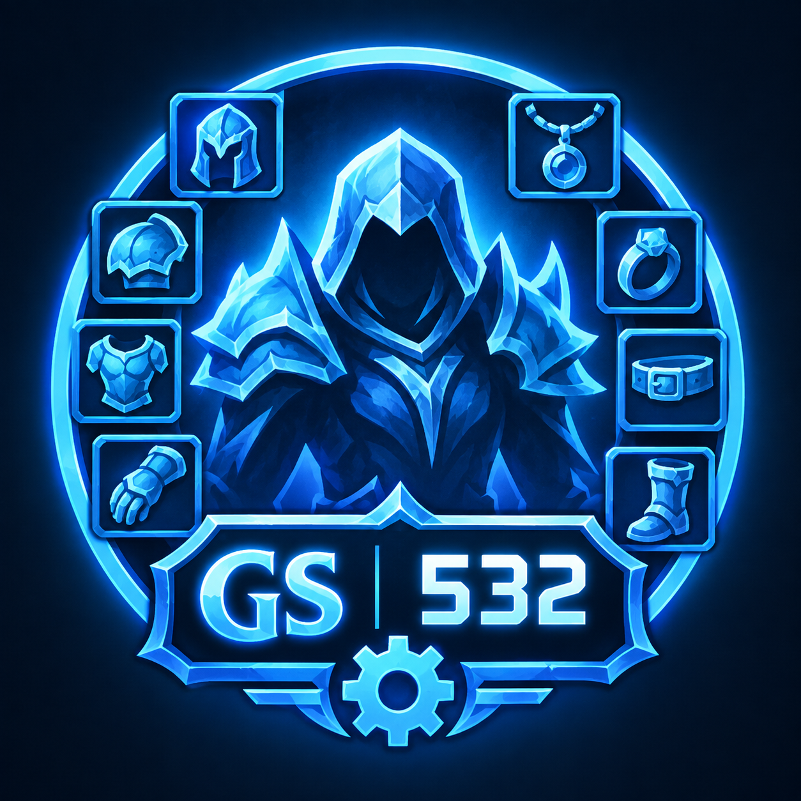

  

<h1 align="center">GearScore (Forever)</h1>

  <strong>The classic GearScore, for WoW Forever.</strong> 
  <em>Le GearScore classique, pour WoW Forever.</em>

  <a href="#english">English</a> · <a href="#français">Français</a>

## English

GearScore shows the score of items and players in their tooltips, on your character sheet and in the inspect window, in the style of Classic and TBC Classic.

### Features

- **Item tooltips:** the score of the item under your mouse, with a second score for hunters.
- **Player tooltips:** the GearScore of players you mouse over, with their average item level. Players are inspected automatically, and you can turn this off.
- **Character sheet and inspect window:** GearScore and item level under the character model.
- **Enchants:** the short name of each enchant next to its equipment slot.
- **Group scores:** the known scores of your party or raid, sorted from highest to lowest.
- **Options window:** switches for every feature, in collapsible sections, with your current score in the header.
- **Two languages:** English and French. The addon follows your game language, or you can pick one in the options.

### Installation

Copy the `Gearscore_Forever` folder into `Interface\AddOns`, then restart the game.

### Minimap button

| Action | Result |
|---|---|
| Click | Open the options window |
| Drag | Move the button around the minimap |

### Commands

You can use `/gs` or `/gearscore`.

| Command | What it does |
|---|---|
| `/gs` | Show your GearScore |
| `/gs target` | Inspect your target and show its GearScore |
| `/gs group` (or `party`, `raid`) | Show the known GearScores of your party or raid |
| `/gs config` | Open the options window |
| `/gs options` | Print the state of every option |
| `/gs <option>` | Turn an option on or off: `item`, `player`, `ilvl`, `auto`, `sheet`, `inspect`, `enchants`, `minimap` |

## Français

GearScore affiche le score des objets et des joueurs dans leurs infobulles, sur votre fiche de personnage et dans la fenêtre d'inspection, dans le style de Classic et TBC Classic.

### Fonctionnalités

- **Infobulles d'objets :** le score de l'objet sous la souris, avec un second score pour les chasseurs.
- **Infobulles de joueurs :** le GearScore des joueurs survolés, avec leur niveau d'objet moyen. Les joueurs sont inspectés automatiquement, et vous pouvez le désactiver.
- **Fiche de personnage et inspection :** GearScore et niveau d'objet sous le personnage.
- **Enchantements :** le nom abrégé de chaque enchantement à côté de son emplacement.
- **Scores du groupe :** les scores connus de votre groupe ou raid, du plus haut au plus bas.
- **Fenêtre d'options :** un interrupteur par fonctionnalité, en sections repliables, avec votre score actuel dans l'en-tête.
- **Deux langues :** anglais et français. L'addon suit la langue du jeu, ou vous pouvez en choisir une dans les options.

### Installation

Copiez le dossier `Gearscore_Forever` dans `Interface\AddOns`, puis relancez le jeu.

### Bouton de la minicarte

| Action | Résultat |
|---|---|
| Clic | Ouvre la fenêtre d'options |
| Glisser | Déplace le bouton autour de la minicarte |

### Commandes

Vous pouvez utiliser `/gs` ou `/gearscore`.

| Commande | Effet |
|---|---|
| `/gs` | Affiche votre GearScore |
| `/gs target` | Inspecte votre cible et affiche son GearScore |
| `/gs group` (ou `party`, `raid`) | Affiche les GearScores connus de votre groupe ou raid |
| `/gs config` | Ouvre la fenêtre d'options |
| `/gs options` | Affiche l'état de chaque option |
| `/gs <option>` | Active ou désactive une option : `item`, `player`, `ilvl`, `auto`, `sheet`, `inspect`, `enchants`, `minimap` |
